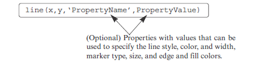
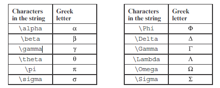
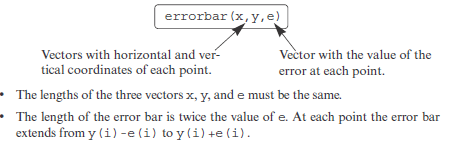
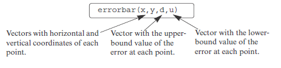
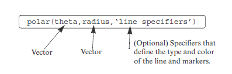

# Fucking notes to remember


**Figure 5-1:** Example of a formatted two-dimensional plot

______________________________________________________________________________________________

# THE plot COMMAND

```matlab
plot(x,y)  % to create two-dimensional plots
```
two vectors must have the same number of elements


----------------------------------------------------------------------------------------------------------
# Line Specifiers

## Line Style

| Line Style      | Specifier |
| --------------- | --------- |
| solid (default) | -         |
| dashed          | --        |
| dotted          | :         |
| dash-dot        | -.        |

-----------------------------------------------------------------------------------

## Line Color

| Color   | Specifier |
| ------- | --------- |
| red     | r         |
| green   | g         |
| blue    | b         |
| cyan    | c         |
| magenta | m         |
| yellow  | y         |
| black   | k         |
| white   | w         |

------------------------------------------------------------------------------

## Marker Type Specifiers

| Marker Type              | Specifier |
| ------------------------ | --------- |
| plus sign                | +         |
| circle                   | o         |
| asterisk                 | *         |
| point                    | .         |
| cross                    | x         |
| triangle (pointed up)    | ^         |
| triangle (pointed down)  | v         |
| triangle (pointed left)  | <         |
| triangle (pointed right) | >         |
| square                   | s         |
| diamond                  | d         |
| five-pointed star        | p         |
| six-pointed star         | h         |

----------------------------------------------------------------------------------------------------------------------------

## Notes about using the specifiers

* The specifiers are typed inside the plot command as strings
* Within the string the specifiers can be typed in any order
* The specifiers are optional

Examples:

```matlab
plot(x,y)           % A blue solid line connects the points with no markers (default)
plot(x,y,'r')       % A red solid line connects the points
plot(x,y,'--y')     % A yellow dashed line connects the points
plot(x,y,'*')       % The points are marked with * (no line between the points)
plot(x,y,'g:d')     % A green dotted line connects the points that are marked with diamond markers
```

--------------------------------------------------------------------------------------------------------------------------------------------------------------------------------------------------------------------------

# Property Name and Property Value

```matlab
plot(x,y,'-mo','LineWidth',2,'MarkerSize',12,'MarkerEdgeColor','g','MarkerFaceColor','y')
```

| Property Name   | Description                                                           | Possible Values                                                               |
| --------------- | --------------------------------------------------------------------- | ----------------------------------------------------------------------------- |
| LineWidth       | Specifies the width of the line                                       | A number in units of points (default 0.5) (or LineWidth)                      |
| MarkerSize      | Specifies the size of the marker                                      | A number in units of points (or MarkerSize)                                   |
| MarkerEdgeColor | Specifies the color of the marker or the edge line for filled markers | Color specifiers from the table above, typed as a string (or MarkerEdgeColor) |
| MarkerFaceColor | Specifies the color of the filling for filled markers                 | Color specifiers from the table above, typed as a string (or MarkerFaceColor) |

_______________________________________________________________________________________________________________________________________________________________________

# THE fplot COMMAND


* limits: The limits argument is a vector with two elements that specify the domain of x [xmin,xmax], or a vector with four elements that specifies the domain of x and the limits of the y-axis [xmin,xmax,ymin,ymax].

____________________________________________________________________________________________________________________________________________________________________________________________________________________________

# PLOTTING MULTIPLE GRAPHS IN THE SAME PLOT

```matlab
plot(x,y,u,v,t,h)
```
\- creates three graphs—y vs. x, v vs. u, and h vs. t—all in the same plot

* The vectors of each pair must be of the same length

```matlab
plot(x,y,‘-b’,u,v,‘--r’,t,h,‘g:’)
```
\- plots y vs. x with a solid blue line, v vs.u with a dashed red line, and h vs. t with a dotted green line

______________________________________________________________________________________________________________________

# Using the hold on and hold off Commands

```matlab
x=[-2:0.01:4];
y=3*x.^3-26*x+6;
yd=9*x.^2-26;    
ydd=18*x;
plot(x,y,'-b')                 % The first graph is created
hold on
plot(x,yd,'--r')               % Two more graphs are added to the figure
plot(x,ydd,':k')
hold off
```
__________________________________________________________________________________________________________________________________________

# Using the line Command

\- graphs (lines) can be added to a plot that already exists



```matlab
line(x,y,‘linestyle’,‘--’,‘color’,‘r’,‘marker’,‘o’)
```
\- add a dashed red line with circular markers to a plot that already exists

* the plot command starts a new plot every time it is executed, while the line command adds lines to a plot that already exists

________________________________________________________________________________________________________________________________________

# Formatting a Plot Using Commands

## The xlabel and ylabel commands

\- Labels can be placed next to the axes with the xlabel and ylabel command

```matlab
xlabel(‘text as string’)
ylabel(‘text as string’)
```
_______________________________________________________________________________________________________

## The title command

\- A title can be added to the plot with the command

```matlab
title(‘text as string’)
```
_____________________________________________________________________________________________________

## The text command

\- A text label can be placed in the plot with the text or gtext commands

| Command   | Meaning                                                                 |
|-----------|-------------------------------------------------------------------------|
| `text(x,y,'string')`  | Places text at coordinates (x,y) **according to the axes** in the figure |
| `gtext('string')`     | User clicks figure to place text interactively                             |

_____________________________________________________________________________________________________________________________________________________________

## The legend command

\- The legend shows a sample of the line type of each graph that is plotted, and places a label, specified by the user, beside the line sample

```matlab
legend(‘string1’,‘string2’, ..... ,‘Location’,‘pos’)
```
* The ‘Location’,‘pos’ are optional strings that specifies where in the figure the legend is to be placed

### Several options

| Position | Meaning                                                                 |
|----------|-------------------------------------------------------------------------|
| `NE`     | Upper-right corner (default)                                            |
| `NW`     | Upper-left corner                                                       |
| `SE`     | Lower-right corner                                                      |
| `SW`     | Lower-left corner                                                       |
| `B`      | Inside plot, least interference with graphs                             |
| `BO`     | Outside plot, least used space                                          |

_____________________________________________________________________________________________________________________________________________________________________

# Formatting the text within the xlabel, ylabel, title, text and legend commands

* The formatting can be done either by adding modifiers inside the string

| Modifier                  | Effect                                 |
|---------------------------|---------------------------------------|
| `\bf`                     | Bold font                               |
| `\it`                     | Italic style                            |
| `\rm`                     | Normal font                             |
| `\fontname{fontname}`     | Use specified font                      |
| `\fontsize{fontsize}`     | Use specified font size                 |

---------------------------------------------------------------------------------------------------------------------------------------

### Subscript and superscript

| Symbol         | Meaning                                                                 |
|----------------|-------------------------------------------------------------------------|
| `_char`        | Display single character as **subscript**                                |
| `^char`        | Display single character as **superscript**                              |
| `_{chars}`     | Display multiple characters as **subscript**                             |
| `^{chars}`     | Display multiple characters as **superscript**                           |

--------------------------------------------------------------------------------------------------------------

### Greek characters



__________________________________________________________________________________________________________________________________________________________________________________________________________________

* Formatting of the text that is displayed by the xlabel, ylabel, title, and text commands can also be done by adding optional PropertyName and PropertyValue arguments following the string inside the command

```matlab
text(x,y,‘text as string’,PropertyName,PropertyValue)
```
| Property       | Description                                         | Possible Values / Default         |
|----------------|-----------------------------------------------------|----------------------------------|
| `Rotation`     | Orientation of the text                             | Scalar (degrees), Default: 0     |
| `FontAngle`    | Italic or normal style                               | normal, italic, Default: normal  |
| `FontName`     | Font of the text                                     | Any system font                  |
| `FontSize`     | Size of the font                                     | Scalar (points), Default: 10     |
| `FontWeight`   | Weight of characters                                 | light, normal, bold, Default: normal |
| `Color`        | Text color                                          | Color specifiers                 |
| `BackgroundColor` | Background color of rectangular text box         | Color specifiers                 |
| `EdgeColor`    | Color of edge around text box                        | Color specifiers, Default: none  |
| `LineWidth`    | Width of edge around text box                        | Scalar (points), Default: 0.5    |

_______________________________________________________________________________________________________________________________________________________________________________________________________________________

## The axis command

\- to change the range and the appearance of the axes

| Command                          | Meaning                                                                 |
|----------------------------------|-------------------------------------------------------------------------|
| `axis([xmin,xmax,ymin,ymax])`    | Set limits of both x and y axes (xmin, xmax, ymin, ymax are numbers)   |
| `axis equal`                     | Use the same scale for both axes                                        |
| `axis square`                    | Set the axes region to be square                                        |
| `axis tight`                     | Set axis limits to fit the range of the data                             |

______________________________________________________________________________________________________________________________

## The grid command

| Command   | Meaning                   |
|-----------|---------------------------|
| `grid on` | Add grid lines to the plot |
| `grid off`| Remove grid lines from the plot |

___________________________________________________________________________________________________________________

# PLOTS WITH LOGARITHMIC AXES

| Command          | Meaning                                                                 |
|-----------------|-------------------------------------------------------------------------|
| `semilogy(x,y)`  | y vs x plot with **log10 y-axis** and linear x-axis                     |
| `semilogx(x,y)`  | y vs x plot with **log10 x-axis** and linear y-axis                     |
| `loglog(x,y)`    | y vs x plot with **log10 scale for both axes**                           |

* Notes for plots with logarithmic axes
  * The number zero cannot be plotted on a log scale (since a log of zero is not defined).
  * Negative numbers cannot be plotted on log scales (since a log of a negative number is not defined).

_________________________________________________________________________________________________________________________

# PLOTS WITH ERROR BARS


The command for making a plot with error bars that are symmetric


The command for making a plot with error bars that are not symmetric

* The lengths of the four vectors x, y, d, and u must be the same.
* At each point the error bar extends from y(i)-d(i) to y(i)+u(i).

______________________________________________________________________________________________________________________________________________________________________________________

# HISTOGRAMS

\- A histogram is a vertical bar graph that shows how data is distributed by splitting the data range into bins and displaying how many values fall into each bin

```matlab
hist(y)
```

* y is a vector with the data points.
* MATLAB divides the range of the data points into 10 equally spaced subranges (bins) and then plots the number of data points in each bin

```matlab
hist(y,nbins)
% or
hist(y,x)
```
* nbins is a scalar that defines the number of bins.
* MATLAB divides the range in equally spaced subranges.

* x is a vector that specifies the location of the center of each bin (the distance between the centers does not have to be the same for all the bins).
* The edges of the bins are at the middle point between the centers.

---------------------------------------------------------------------------------------------------------------------------------------------------------------------------------------

* The output n is a vector
* The number of elements in n is equal to the number of bins

```matlab
n=hist(y)
n=hist(y,nbins)
n=hist(y,x)
```
---------------------------------------------------------------------------------------

* optional numerical output is the location of the bins

```matlab
[n xout]=hist(y)
[n xout]=hist(y,nbins)
```

________________________________________________________________________________________________________________________

# POLAR PLOTS

\- The polar command is used to plot functions in polar coordinates (the angle and the radius (distance) to the point)



______________________________________________________________________________________________________________________________________________

# PUTTING MULTIPLE PLOTS ON THE SAME PAGE

\- Multiple plots can be created on the same page with the subplot command

```matlab
subplot(m,n,p)
```
* the command subplot(3,2,1) creates six areas arranged in three rows and two columns as shown, and makes the upper left subplot current

________________________________________________________________________________________________________________________________________________

# Windows can be closed with the close command

| Command      | Meaning                              |
|--------------|--------------------------------------|
| `close`      | Close the active Figure Window        |
| `close(n)`   | Close the nth Figure Window           |
| `close all`  | Close all open Figure Windows         |

_______________________________________________________________________________________________


