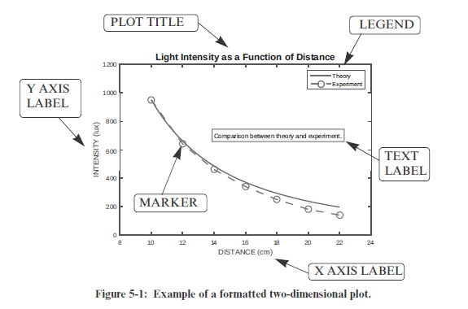
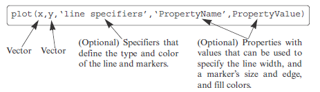

Fucking notes to remember

Figure 5-1: Example of a formatted two-dimensional plot

______________________________________________________________________________________________

THE plot COMMAND

plot(x,y)  -  to create two-dimensional plots

two vectors must have the same number of elements

----------------------------------------------------------------------------------------------------------
