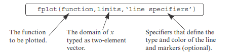

# Fucking notes to remember


**Figure 5-1:** Example of a formatted two-dimensional plot

______________________________________________________________________________________________

# THE plot COMMAND

```matlab
plot(x,y)  % to create two-dimensional plots
```
two vectors must have the same number of elements


----------------------------------------------------------------------------------------------------------
# Line Specifiers

## Line Style

| Line Style      | Specifier |
| --------------- | --------- |
| solid (default) | -         |
| dashed          | --        |
| dotted          | :         |
| dash-dot        | -.        |

-----------------------------------------------------------------------------------

## Line Color

| Color   | Specifier |
| ------- | --------- |
| red     | r         |
| green   | g         |
| blue    | b         |
| cyan    | c         |
| magenta | m         |
| yellow  | y         |
| black   | k         |
| white   | w         |

------------------------------------------------------------------------------

## Marker Type Specifiers

| Marker Type              | Specifier |
| ------------------------ | --------- |
| plus sign                | +         |
| circle                   | o         |
| asterisk                 | *         |
| point                    | .         |
| cross                    | x         |
| triangle (pointed up)    | ^         |
| triangle (pointed down)  | v         |
| triangle (pointed left)  | <         |
| triangle (pointed right) | >         |
| square                   | s         |
| diamond                  | d         |
| five-pointed star        | p         |
| six-pointed star         | h         |

----------------------------------------------------------------------------------------------------------------------------

## Notes about using the specifiers

* The specifiers are typed inside the plot command as strings
* Within the string the specifiers can be typed in any order
* The specifiers are optional

Examples:

```matlab
plot(x,y)           % A blue solid line connects the points with no markers (default)
plot(x,y,'r')       % A red solid line connects the points
plot(x,y,'--y')     % A yellow dashed line connects the points
plot(x,y,'*')       % The points are marked with * (no line between the points)
plot(x,y,'g:d')     % A green dotted line connects the points that are marked with diamond markers
```

--------------------------------------------------------------------------------------------------------------------------------------------------------------------------------------------------------------------------

# Property Name and Property Value

```matlab
plot(x,y,'-mo','LineWidth',2,'MarkerSize',12,'MarkerEdgeColor','g','MarkerFaceColor','y')
```

| Property Name   | Description                                                           | Possible Values                                                               |
| --------------- | --------------------------------------------------------------------- | ----------------------------------------------------------------------------- |
| LineWidth       | Specifies the width of the line                                       | A number in units of points (default 0.5) (or LineWidth)                      |
| MarkerSize      | Specifies the size of the marker                                      | A number in units of points (or MarkerSize)                                   |
| MarkerEdgeColor | Specifies the color of the marker or the edge line for filled markers | Color specifiers from the table above, typed as a string (or MarkerEdgeColor) |
| MarkerFaceColor | Specifies the color of the filling for filled markers                 | Color specifiers from the table above, typed as a string (or MarkerFaceColor) |

_______________________________________________________________________________________________________________________________________________________________________

# THE fplot COMMAND



* limits: The limits argument is a vector with two elements that specify the domain of x [xmin,xmax], or a vector with four elements that specifies the domain of x and the limits of the y-axis [xmin,xmax,ymin,ymax].

____________________________________________________________________________________________________________________________________________________________________________________________________________________________

# PLOTTING MULTIPLE GRAPHS IN THE SAME PLOT

```matlab
plot(x,y,u,v,t,h)
```
\- creates three graphs—y vs. x, v vs. u, and h vs. t—all in the same plot

* The vectors of each pair must be of the same length

```matlab
plot(x,y,‘-b’,u,v,‘--r’,t,h,‘g:’)
```
\- plots y vs. x with a solid blue line, v vs.u with a dashed red line, and h vs. t with a dotted green line

______________________________________________________________________________________________________________________

# Using the hold on and hold off Commands

```matlab
x=[-2:0.01:4];
y=3*x.^3-26*x+6;
yd=9*x.^2-26;    
ydd=18*x;
plot(x,y,'-b')                 % The first graph is created
hold on
plot(x,yd,'--r')               % Two more graphs are added to the figure
plot(x,ydd,':k')
hold off
```
__________________________________________________________________________________________________________
